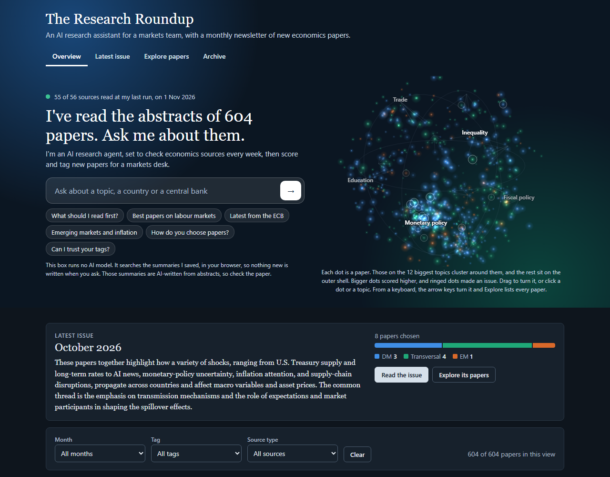
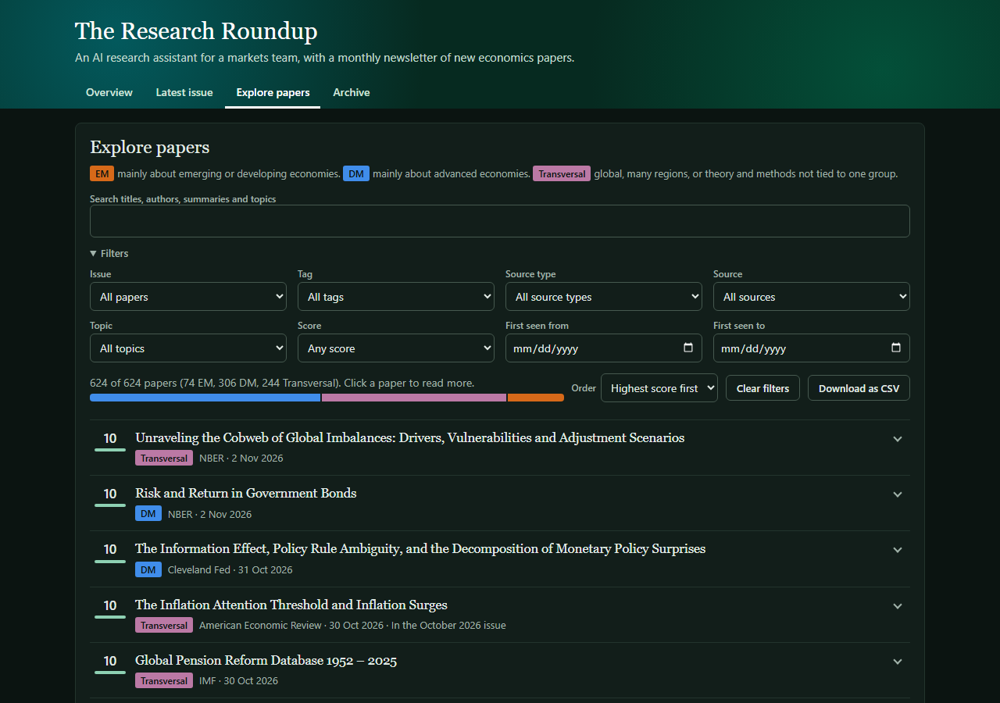

# The Research Roundup

An automated Python agent that watches economics research and builds a monthly newsletter for a markets research team.

Every week it collects new papers from journals, central banks and research bodies, and uses AI to summarise, score and tag each one as EM, DM or Transversal. Every month it picks 5 to 8 papers and builds a responsive HTML newsletter. A public site shows each issue, a dashboard of everything read so far, a 3D map of the papers, and a searchable list. You can also ask it questions: it searches the summaries it saved, in your browser, so no AI model runs at that moment and nothing new is written.

## Review in 5 minutes

1. **The newsletter:** the [October 2026 issue](https://ouailabed.github.io/research-roundup/issues/2026-10.html) and the [September 2026 issue](https://ouailabed.github.io/research-roundup/issues/2026-09.html).
2. **The dashboard:** [the live site](https://ouailabed.github.io/research-roundup/). Explore papers lists every paper the agent has read, with filters and each paper's tag, reason and metadata. Archive has both issues and the latest source report.
3. **Sources:** 55 of 56 sources work. The Reserve Bank of New Zealand refuses scripts and its RePEc series stops in 2024, so it isn't covered. [Sources](#sources) shows each route and fallback.
4. **Quality:** Codex tagged all 626 papers saved by 2 November, blind, and matched our tags on 91.4%, I read through the tags myself, and every new write-up is fact-checked before an issue is built. See [How the tags and summaries were checked](#how-the-tags-and-summaries-were-checked).
5. **Run it yourself:** the dashboard runs locally with no API key. See [Run it locally](#run-it-locally).

| The home page | The newsletter | Exploring the papers |
|---|---|---|
|  |  |  |

## How it works

```
Feeds and APIs (56 sources)
      |
   collect       saves new papers to SQLite, no duplicates
      |
   analyse       cheap AI model: summary, tag and score for each paper
      |
 build-issue     stronger model ranks the top papers, rules pick 5 to 8, it writes them up, builds the HTML
      |
   publish       writes the public site: latest issue, paper explorer and archive

GitHub Actions runs everything every Monday and builds the new issue on the 1st of each month.
A small catch-up job picks up anything a run left behind at Groq's daily limit, and restarts itself until it's done.
```

| Folder | What is in it |
|---|---|
| `src` | The Python code |
| `config` | `sources.yaml` lists every source and `settings.yaml` holds the model names |
| `data` | The SQLite database |
| `templates` | The newsletter layout and the public site's page |
| `site` | The public site and the finished newsletters |
| `tests` | The automatic tests |
| `docs` | The screenshots, and the full record of the quality checks |
| `app.py` | A Streamlit version of the dashboard, for running locally |

## Sources

56 source entries cover the five journals, NBER, BPEA, the IMF, the BIS, all G10 central banks, the ECB, the 12 regional Feds and 20 other European central banks. 55 work and 1 is not covered.

| Source | Route | Status | Papers with no abstract |
|---|---|---|---|
| NBER | Own feed, dates from Crossref | Working | 0 |
| IMF | Crossref | Working | 0 |
| BIS | Own feed | Working | 0 |
| BPEA | Crossref | Working | 0 |
| Federal Reserve Board | Crossref | Working | 0 |
| Bank of England | RePEc IDEAS | Fallback | 0 |
| European Central Bank | RePEc IDEAS | Fallback | 0 |
| Bank of Canada | DataCite | Working | 0 |
| Bank of Japan | RePEc IDEAS | Fallback | 0 |
| Banque de France | RePEc IDEAS | Fallback | 0 |
| Deutsche Bundesbank | RePEc IDEAS | Fallback | 0 |
| Banca d'Italia | RePEc IDEAS | Fallback | 0 |
| De Nederlandsche Bank | RePEc IDEAS | Fallback | 0 |
| National Bank of Belgium | RePEc IDEAS | Fallback | 0 |
| Sveriges Riksbank | RePEc IDEAS | Fallback | 0 |
| Swiss National Bank | RePEc IDEAS | Fallback | 0 |
| Reserve Bank of Australia | Crossref | Working | 0 |
| Reserve Bank of New Zealand | None | Not covered | 0 |
| Boston Fed | RePEc IDEAS | Fallback | 0 |
| New York Fed | Crossref | Working | 0 |
| Philadelphia Fed | RePEc IDEAS | Fallback | 0 |
| Cleveland Fed | Crossref | Working | 0 |
| Richmond Fed | RePEc IDEAS | Fallback | 0 |
| Atlanta Fed | RePEc IDEAS | Fallback | 0 |
| Chicago Fed | RePEc IDEAS | Fallback | 0 |
| St. Louis Fed | RePEc IDEAS | Fallback | 0 |
| Minneapolis Fed Staff Reports | RePEc IDEAS | Fallback | 0 |
| Minneapolis Fed Working Papers | RePEc IDEAS | Fallback | 0 |
| Kansas City Fed | RePEc IDEAS | Fallback | 0 |
| Dallas Fed | RePEc IDEAS | Fallback | 0 |
| San Francisco Fed | Crossref | Working | 0 |
| Banco de Espana | RePEc IDEAS | Fallback | 0 |
| Banco de Portugal | RePEc IDEAS | Fallback | 0 |
| Bank of Finland | RePEc IDEAS | Fallback | 0 |
| Central Bank of Ireland | RePEc IDEAS | Fallback | 0 |
| Oesterreichische Nationalbank | RePEc IDEAS | Fallback | 1 |
| Norges Bank | Own feed | Working | 0 |
| Danmarks Nationalbank | EconStor feed | Fallback | 0 |
| Narodowy Bank Polski | RePEc IDEAS | Fallback | 0 |
| Czech National Bank | RePEc IDEAS | Fallback | 0 |
| Magyar Nemzeti Bank | RePEc IDEAS | Fallback | 0 |
| Bank of Greece | RePEc IDEAS | Fallback | 0 |
| Latvijas Banka | RePEc IDEAS | Fallback | 0 |
| Bank of Lithuania | RePEc IDEAS | Fallback | 0 |
| Eesti Pank | RePEc IDEAS | Fallback | 2 |
| National Bank of Slovakia | RePEc IDEAS | Fallback | 0 |
| Croatian National Bank | RePEc IDEAS | Fallback | 0 |
| Central Bank of Iceland | RePEc IDEAS | Fallback | 0 |
| Banque centrale du Luxembourg | RePEc IDEAS | Fallback | 0 |
| Central Bank of Cyprus | RePEc IDEAS | Fallback | 0 |
| National Bank of Ukraine | RePEc IDEAS | Fallback | 0 |
| American Economic Review | OpenAlex | Working | 3 |
| Econometrica | Crossref | Working | 3 |
| Journal of Political Economy | OpenAlex, abstracts from RePEc IDEAS | Working | 21 |
| Quarterly Journal of Economics | OpenAlex | Working | 0 |
| Review of Economic Studies | OpenAlex | Working | 0 |

**Working** means the publisher's own feed or an official registry (Crossref, DataCite, OpenAlex).

**Fallback** means RePEc IDEAS or EconStor, open catalogues that give the same fields for each series. These are used when a bank's own feed has no abstracts or authors, or when Crossref has the DOIs but no abstracts. Each entry in `config/sources.yaml` has a note saying why.

**Not covered:** the Reserve Bank of New Zealand. Its site answered 403 to a script, RePEc stops in 2024, and the agent never disguises itself as a browser. A few smaller European central banks are also missing: Malta's RePEc series stops in 2023, and no RePEc series turned up for Slovenia, Bulgaria, Romania or Serbia.

The rules for every source: feeds and official APIs first, respect `robots.txt`, about 1 request per second, a clear User-Agent, and no attempts to get around a paywall. Papers with no abstract are kept in the database but left out of the analysis for that cycle. This mainly affects the Journal of Political Economy: OpenAlex has few of its abstracts and RePEc lists new papers late, so each run tries RePEc again. Journal housekeeping such as Front Matter and Recent Referees is dropped, so it doesn't count as missing.

## How the analysis and tags work

The AI reads only each paper's title, abstract and metadata. The prompt tells it never to add findings or numbers. Its answer must match a fixed JSON shape, which `pydantic` checks. A bad answer is retried once and logged, and a paper that fails on 3 separate runs is skipped.

Tags follow one rule set, based on the IMF's list of 43 advanced economies:

- **DM:** mainly about advanced economies.
- **EM:** mainly about emerging or developing economies.
- **Transversal:** global, many regions, or theory and methods not tied to one group.

Two models keep the work inside Groq's free limits. `openai/gpt-oss-20b` scores every paper at low effort, and `openai/gpt-oss-120b` takes over if it runs out for the day. `openai/gpt-oss-120b` also writes the full analysis, only for the papers chosen for an issue. Every result is saved with its model name and date, so the same model never reads the same paper twice, and a run that stops at the daily limit carries on from where it stopped.

### How the tags and summaries were checked

- **My own check:** I read through the tags myself and agreed with most of them. It wasn't a blind test, so it isn't an accuracy figure.
- **A blind AI check of every tag:** Codex tagged all 626 papers then saved, without seeing our tags, and matched ours on 572: 91.4%, with a 95% range of 88.9% to 93.3%. A second AI reader checked each disagreement against the abstract, and 23 tags were changed.
- **The write-ups:** an AI audit of the first 16 found 8 with a reversed or unsupported claim. All were corrected, and every new write-up now goes through a fact-check step before the issue is built.
- **The short summaries:** all 610 then saved were checked against their abstracts. 27 confirmed problems were corrected, and 58 loose ones were left as they are.
- **The numbers:** `python -m src.main check` compares every number in a summary with its abstract. Of 624 summaries it flagged 6, and all 6 were rounding or simple sums.

Apart from my own read-through, these are AI checks of AI work. They show the tags follow the written rules, not that every tag is right, so a person should still read each issue before it goes out. [docs/quality-checks.md](docs/quality-checks.md) has the full record, with every figure and how to reproduce it.

## How papers are chosen

Each month's selection works like an editor's desk. A score alone can't pick the issue: in October 145 of 295 papers scored 9 or 10, and the two models use the scale a little differently. So `openai/gpt-oss-120b` reads every paper scoring 9 or 10, in groups of 40, and ranks the ones most useful to a markets team. The issue takes the top of that ranking, at most 2 papers per source, with a mix of EM, DM and Transversal where possible. It also writes a short opening note on what the papers tell the team. A paper belongs to the month it was first seen, because published dates are unreliable. The backfilled September and October issues are the exception: they use the best date each source gives. Once chosen, an issue's list is saved, so the same month always gives the same issue.

## Run it locally

You need Python 3.13 or newer, and Git. It is tested on 3.13 and 3.14.

```powershell
git clone https://github.com/Ouailabed/research-roundup.git
cd research-roundup
python -m venv .venv
.\.venv\Scripts\Activate.ps1
python -m pip install -r requirements.txt
Copy-Item .env.example .env
```

On Mac or Linux, use `source .venv/bin/activate` and `cp .env.example .env`.

The repo comes with saved data, so the dashboard works straight away with no keys:

```powershell
python -m streamlit run app.py
```

To run the agent, open `.env` and fill in the values. You only need `GROQ_API_KEY`, which you can get for free at console.groq.com, and it also runs the fact-check. `OPENALEX_API_KEY` is optional. `CONTACT_EMAIL` is sent to sources in the User-Agent, so they can reach you. Then:

```powershell
python -m src.main collect
python -m src.main analyse
python -m src.main build-issue --month 2026-10
python -m src.main run
```

`run` collects, analyses, builds any missing issue and writes the public site. `python -m src.main catch-up` does the same, but collects only if no run has for a week. `python -m src.main left` prints how many papers and issues are still waiting. With no key, `analyse` says so and the saved results are used.

To run the tests:

```powershell
python -m pytest
```

## Deploy it

1. Fork or push this repo to GitHub, as a public repo.
2. Add `GROQ_API_KEY` under Settings, Secrets and variables, Actions. `OPENALEX_API_KEY` and `CONTACT_EMAIL` are optional. To measure the fact-check, start Measure the fact-checker on the Actions tab.
3. Under Settings, Pages, set the source to GitHub Actions.
4. On a fork, first turn on workflows on the Actions tab, because GitHub leaves them off.
5. Start Weekly run by hand with Run workflow on the Actions tab. After that the workflows in `.github/workflows` run on their schedules, but GitHub doesn't promise when a scheduled run starts (see Limits), so any job can be started the same way.

The public site is a static page with no server, so it needs no account and never goes to sleep. `app.py` can also be deployed on Streamlit Community Cloud if you prefer: choose this repo, set the main file to `app.py`, and pick Python 3.13 or newer under Advanced settings.

## Monthly cost

Nothing. Groq's free tier gave each model 1,000 requests a day, 8,000 tokens a minute and 200,000 tokens a day on 31 October 2026. GitHub Actions and Streamlit Community Cloud are free for this size of project. A normal month has about 300 new papers, and scoring one paper uses about 850 tokens. That is about 255,000 tokens a month, but weekly runs spread it to about 60,000 tokens a week, well inside the daily allowance. The editor's ranking and the write-ups add about 50,000 tokens an issue on the stronger model.

The fact-check also runs on the free tier. On the day an issue is built it adds at most 16 calls to `openai/gpt-oss-120b`, two for each of 8 write-ups, which shares that model's daily allowance with the editor and the write-ups. If the allowance runs out, the issue waits and the catch-up job finishes it later.

## Limits and next steps

- Abstracts only. The agent never reads full papers, so it can only be as good as the abstract.
- RePEc can lag a bank's own site by a few weeks.
- Eight series give only a year, so they could not join the backfilled September and October issues. New papers from them are dated by the day the agent first sees them.
- The free tier is slow: about 10 papers a minute, and the daily allowance refills steadily rather than all at once. A big backlog takes a few days, which the catch-up job handles without help.
- GitHub doesn't promise when a scheduled run starts, and it can skip one. On this repo the 06:30 and 07:00 runs on 1 November never came, and the first scheduled run fired at 17:56 that day, about 5 hours late, though every manual run worked. So the catch-up job restarts itself while work is left, and it collects if no run has for a week. Any job can also be started by hand with Run workflow on the Actions tab. `timer.yml` can stand in for cron if it stays silent: it waits 7 days on a deployment environment, using no runner, then starts the weekly run and itself. It is off until someone starts it.
- Scores bunch at 5 and 9, because the prompt names those values. The editor step works around this, but a better scale would need every paper scored again.
- The fact-check only covers the 5 to 8 write-ups in each issue. The short summaries of every other paper aren't checked.
- With more time: direct routes for the banks now on RePEc, a way to read the Reserve Bank of New Zealand if it opens an API, a blind human check of the tags, and a person reading each issue before it goes out.

## How I built it

I built this project with AI coding tools. Claude Code was my main tool, and I used Codex to review the work and point out what was going wrong. I tested the results against the brief and checked the tags myself.
